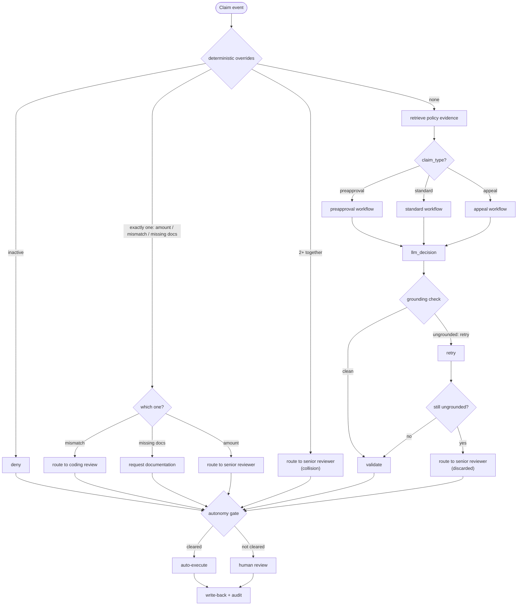
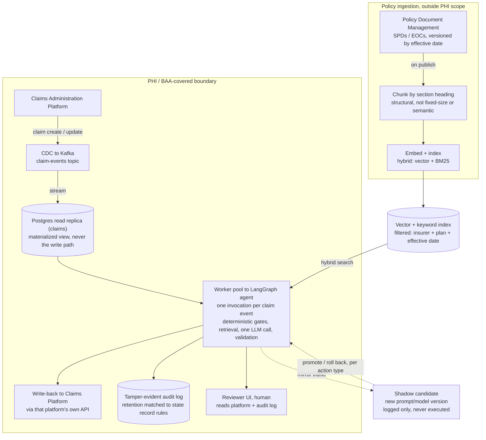
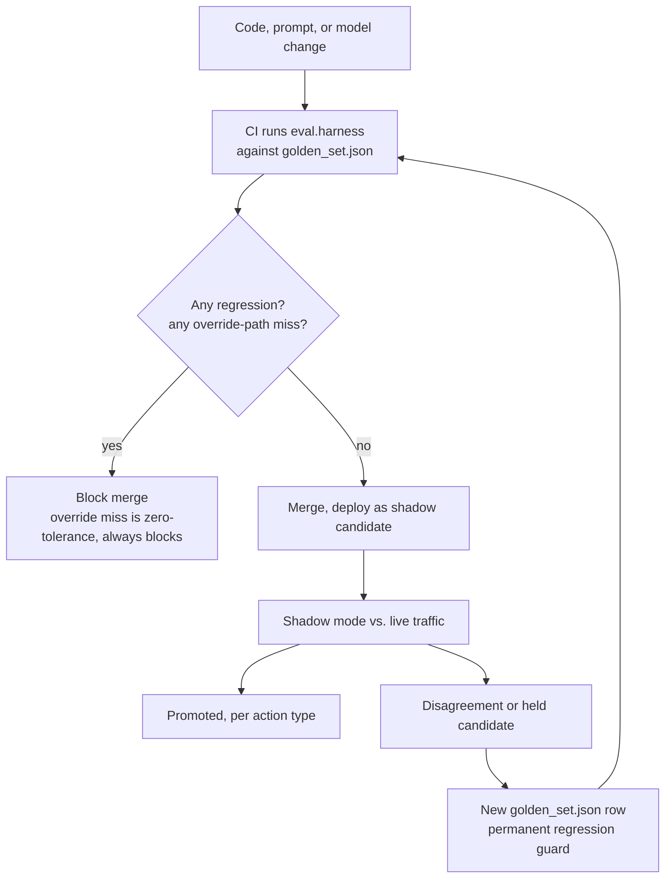
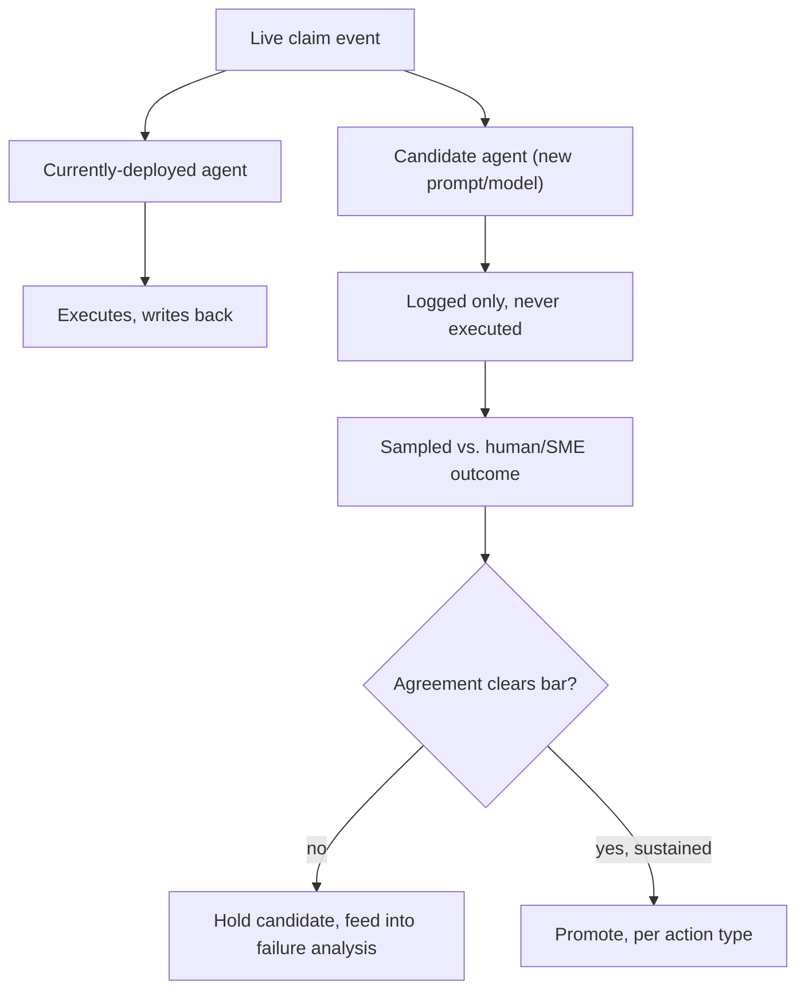

# Medical Insurance Claims Review Agent: Design Report
# Agent Design Overview

This report is divided into 4 main sections:
1. Claims workflow/agent orchestration
2. Design of system + storage and retrieval of documents
3. Evaluation suite
4. Escalation, Contradictions and Discussion

**Assumptions:**
- Production use case takes place in USA with HIPAA laws, BAA and PHI considerations.
- A claim is associated with a `plan_id` which can be mapped to appropriate policy plan.
- Policy documents are assumed to have relatively stable, numbered-section structure and to be machine-readable PDFs.
- Assume policy documents can be hard-filtered by insurer/plan_id/effective date.
- For the MVP assume that supplemental/clinical documents are correctly named and present, without verifying their content.
- For the MVP assume policy plans are short enough to fit fully into context.
- For the MVP assume `preapproval` requires `clinical_note`, `appeal` requires `appeal_letter` as documents.
- In production, assume there is a map between diagnosis and procedure code that can be checked to verify consistency.
- Claims data is PHI and remains in the payer's existing claims-administration platform. Agent reads CDC-fed, read-only Postgres replica, and every decision writes back through that platform's own API
- Policy documents are not PHI, live in a separate document-management system.

## In General
The agent makes policy-aligned decisions from two inputs: structured claim data
and unstructured policy text. 

Agent call only runs when override conditions are not met. LangGraph manages the claim workflow: deterministic gates can resolve a
claim without the model; otherwise it retrieves policy evidence, calls the LLM,
and decides on one of six given function calls. 

The output of the agent is validated. The action call, evidence pointers, payment, and documents are checked. Ambiguous or unresolved cases go to human review. OpenTelemetry traces graph nodes;
Langfuse records prompts, evidence, tool calls, latency, and cost.

Validation has two stages: a grounding check verifies cited evidence, with one
correction retry before an ungrounded decision is discarded and escalated; a
second deterministic check verifies the action, payment, and documents. Offline
evaluation uses a curated golden set to score accuracy and grounding.

The **MVP** was implemented using Claude Agent SDK (Sonnet 5) through
schema-constrained tool, `submit_claim_decision`. In production, this should be a BAA covered API endpoint.

## 1. Agent workflow: claim state to next action

### 1.1 Claims and Policies
In the given example, claims data is structured as such:
```python 
{
"claim_id": "CLM1001",
"member_status": "active",
"claim_type": "preapproval",
"insurance_provider" : "United Healthcare",
"diagnosis_code": "M54.5",
"procedure_code": "MRI-LS-SPINE",
"claimed_amount": 2200,
"supporting_documents": [
"clinical_note"
],
"prior_denial_reason": null,
"provider_notes": "Persistent low back pain for 6 months, conservative therapy failed."
} 
```
The insurance provider can be extracted from `insurance_provider`, however this does not explicitly specify which insurance plan the patient has --> so how do we know which policy to use?

Assume that in the real case, the claim information will include a plan_id of some sort that corresponds to an insurance plan_id, which we can query. 
For the **MVP**, insurance provider simply has a corresponding policy plan.

**General structure of agentic claims workflow.** Using LangGraph for orchestration, OpenTelemetry + Langfuse for observation.




<br>
<br>

### 1.2 Function calls, validation, and observability


**How function calls are chosen, validated, and logged.** The action set has six conceptual function calls:

```text
approve_pre_authorization()
approve_claim_payment(payment_in_dollars: float)
deny_claim()
request_missing_documentation(documents: list[str])
route_to_senior_reviewer()
route_to_coding_review()
```

The model proposes one of the permitted actions through tool calling, and application code deterministically validates the proposed action before execution.
The current schema is:

```python
DECISION_INPUT_SCHEMA = {
    "type": "object",
    "properties": {
        "action": {"type": "string", "enum": ALLOWED_ACTIONS},          # 6 values
        "payment_in_dollars": {"type": "number"},                        # only for approve_claim_payment
        "documents": {"type": "array", "items": {"enum": ALLOWED_DOCUMENTS}},  # only for request_missing_documentation
        "rationale": {"type": "array", "minItems": 1, "items": {
            "properties": {
                "assertion": {"type": "string"},
                "section": {"type": "string"},       # policy evidence pointer
                "excerpt": {"type": "string"},        # verbatim quote from that section, required if section is set
                "claim_field": {"type": "string"},    # claim-data evidence pointer
            }, "required": ["assertion"]}},
        "summary": {"type": "string"},   # any "quoted" span checked verbatim against retrieved policy text
    },
    "required": ["action", "rationale", "summary"],
}
```

 
LangGraph owns the fixed state-machine workflow and conditional routing. Each
node is a real graph node: claim classification, override checks, policy
retrieval, LLM decision, and final validation. The graph runs once per claim
event.

OpenTelemetry wraps every graph node in a span and records the claim ID and
errors. The **MVP** writes spans to a local trace log. Langfuse can attach to the
same LangGraph callback stream.

The agent receives one structured claim. `claim_type`, member status, diagnosis
and procedure codes, amount, documents, insurer, and prior denial data determine
the path.


### 1.3 Overrides
The system performs deterministic checks first for overrides. If overrides occur, skip agent call entirely with deterministic gates based on the type of override.


1. Is the member active?
2. Is the diagnosis/procedure pair clinically consistent?
3. Are required documents present for a preapproval or appeal?
4. Is the amount above an auto-review threshold?


**Claim state to workflow rules to next action.** Four conditions gate every claim, evaluated first and never seen by the model:

| Condition | Action when it fires alone |
|---|---|
| Member inactive at date of service | Deny |
| Claimed amount above the auto-review threshold of 5000 | Route to senior review |
| Diagnosis/procedure code inconsistency | Route to coding review |
| Missing essential documentation for the claim type | Request the missing document(s) |


**Evidence for deterministic override in the MVP.**
Evidence derived from claim data
- `inactive`: uses `member_status`; if it is `inactive`, the claim is denied immediately.
- `mismatch`: uses `diagnosis_code` and `procedure_code`; if the diagnosis is not consistent with the procedure, the claim is routed to coding review. In production, assume there is a map between diagnosis and procedure code that can be checked.
- `missing_docs`: uses `claim_type` and `supporting_documents`.
- `high_amount`: uses `claimed_amount`; if it exceeds the threshold, the claim is routed to senior review.

The MVP does not read the contents of supporting documents; it just checks whether a certain document type exists in `supporting_documents`.


In the case of multiple overrides, we can assume that having an inactive plan simply calls `deny_claim()`. 
In the case of multiple overrides, with active plans (for instance High Claim Amount and Missing Documentation), the actions can depend on whether the client wants to have priority rules/multi-override rules for specific overrides. In the **MVP** case, simply choose to escalate and route to a senior medical reviewer (still skip llm call).

```python
CONDITION_ORDER = ["inactive", "high_amount", "mismatch", "missing_docs"]  # display order only, not a priority

def check_overrides(state):
    claim = state["claim"]
    fired = {
        "inactive": claim["member_status"] == "inactive",
        "mismatch": not is_consistent(claim["diagnosis_code"], claim["procedure_code"]),
        "missing_docs": bool(missing_essential_docs(claim)),
        "high_amount": claim["claimed_amount"] > HIGH_AMOUNT_THRESHOLD,
    }
    triggered = [name for name in CONDITION_ORDER if fired[name]]
    active = [name for name in triggered if name != "inactive"]

    if fired["inactive"]:
        override = "inactive"
    elif len(active) >= 2:
        override = "multiple"          # collision -> escalate, don't rank
    elif len(active) == 1:
        override = active[0]
    else:
        override = None
    return {"override": override, "overrides_triggered": triggered}
```


### 1.4 Agent Call
Only claims with no override reach policy retrieval and the model. The prompt
selects one workflow from the authoritative `claim_type` value:

| Claim type | Required steps |
|---|---|
| `preapproval` | Review coverage and medical necessity; check clinical documents and diagnosis; find missing documents; approve or deny authorization |
| `standard` | Validate coverage; check procedure/diagnosis code consistency; approve and generate payment or deny with a clear reason |
| `appeal` | Retrieve the prior decision and denial reason; check for new, sufficient, relevant appeal evidence; re-evaluate medical justification; overturn or uphold the denial |

Here is a prompt excerpt of the **MVP** listing the logic flow for each claim type: 
```text

### If `claim_type` is `preapproval`
Steps:
1. Review policy document for coverage criteria (ex. Demonstrated medical necessity)
2. Review clinical documents and diagnosis to validate coverage qualification
3. Identify missing documentation if needed
4. Approve or Deny insurance authorization

### If `claim_type` is `standard`
Steps:
1. Validate coverage.
2. Check procedure / diagnosis code consistency.
3. Approve and generate payment, OR deny with a clear reason.

### If `claim_type` is `appeal`
An appeal challenges a previous denial.
Steps:
1. Retrieve prior decision and denial reason.
2. Check whether appeal documentation is:
  - New,
  - Sufficient,
  - Relevant to denial reasons.

3. Re-evaluate medical justification.
4. Approve appeal (overturn) or uphold denial with a clear explanation.


```


<br>
<br>
<br>
<br>

The labels below identify the current LangGraph nodes. Logic described inside a
node is not a separate graph node unless stated otherwise.

1. **`classify_claim` node: read claim state.** Use the supplied claim fields.
    `claim_type` selects the `preapproval`, `standard`, or `appeal` workflow.
2. **`check_overrides` node: run deterministic gates.** Check inactive coverage,
    high amount, diagnosis/procedure mismatch, and missing essential documents.
    Evaluate all four independently and record every fired condition.
3. **Override nodes: resolve early exits.** Inactive claims go to
    `deny_inactive`; high-amount claims go to `high_amount_review`; code
    mismatches go to `coding_review`; missing documents go to `request_docs`.
    Multiple active overrides go to `multi_override_review`. These branches skip
    the LLM.
4. **`retrieve_policy_evidence` node: retrieve policy.** Claims that pass every
    gate use insurer, `plan_id`, and effective date to select policy sections.
    The MVP filters by insurer and returns all sections from the matching policy.
5. **`llm_decision` node: choose one action.** Apply the workflow rules for the
    supplied `claim_type` and select action function. 
6. **Grounding retry inside `llm_decision`.** If an evidence pointer is invalid,
    give the model one correction retry. If it is still invalid, discard the
    proposed action and route to senior review.
7. **`validate_and_finalize` node: validate the result.** Check the action,
    evidence pointers, payment limits, and document names, then produce the final
    response. The current MVP ends here; the production autonomy gate follows
    this step before execution.


### 1.5 Model rationale and grounding check

The model gathers the relevant facts from the claim data and retrieved policy evidence, forms the rationale for its proposed decision, and attaches one evidence pointer to each rationale assertion that contributes to the output. 

Before a claim decision is finalized, the grounding check validates each rationale assertion in three ways:
1. It confirms that any cited policy section is among the sections actually retrieved.
2. For every policy-cited assertion, it also requires `excerpt`, an exact verbatim quote from that section, checked by substring match against the real retrieved text.
3. Any double-quoted span inside `summary` is checked the same way against the full retrieved policy plus this claim's own `provider_notes`/`prior_denial_reason`, since a summary can legitimately quote either source. 

If a pointer is missing, duplicated, invalid, an excerpt doesn't match its section verbatim, a summary quote isn't real, or the rationale is otherwise malformed, the model gets one correction retry. If the output is still invalid after that retry, the proposed decision is discarded and replaced with `route_to_senior_reviewer` rather than executing a weakly grounded result. 

Second, the deterministic validation pass enforces the fixed action schema: valid action names only, payment limits on approved claims, allowed document names on documentation requests, and the final output fields needed for the shared response schema. Any correction is recorded in `validator_notes`, while the same audit trail keeps a trace of the full graph run for review.
Every correction is logged (LangGraph, OTel, LangFuse).


### 1.6 Response Composition

**How decisions are explained clearly and safely.** Every decision, override or model-adjudicated, composes into one schema, so a downstream reviewer or the evaluation harness can treat every decision the same way:

```json
{
  "claim_id": "CLM2002",
  "decision": "deny_claim",
  "summary": "Denied: provider_notes state \"Patient requests MRI for convenience prior to upcoming travel; no new symptoms reported since last visit,\" which fails the policy's Medical Necessity Standard requiring the service be \"Not primarily for convenience of the member or provider\" (§4), and non-medically-necessary services are excluded per §6.",
  "rationale": [
    {"assertion": "Provider notes indicate the MRI is requested for member convenience prior to travel, with no new symptoms since last visit", "source": "claim_data", "field": "provider_notes"},
    {"assertion": "Policy requires services not be primarily for convenience of the member or provider to be considered Medically Necessary", "source": "policy", "insurer": "United Healthcare", "section": "4", "title": "Medical Necessity Standard", "excerpt": "Not primarily for convenience of the member or provider"},
    {"assertion": "Services deemed not Medically Necessary are excluded from coverage", "source": "policy", "insurer": "United Healthcare", "section": "6", "title": "Exclusions", "excerpt": "Services deemed not Medically Necessary"}
  ],
  "next_steps": {"documents_requested": null, "routed_to": null, "payment_in_dollars": null, "recommended_action": null},
  "token_usage": {"input_tokens": 5994, "output_tokens": 3268, "total_tokens": 9262, "cost_usd": 0.0943},
  "disclaimer": "This is a coverage determination based on your plan's policy document and the information on file. It is not medical advice.",
  "validator_notes": []
}
```
<br>
<br>

| Field | Type | Notes |
|---|---|---|
| `decision` | enum, 6 values | Never free text |
| `summary` | string | One concise reviewer-facing sentence explaining the decision and key reason(s); any `"quoted"` span is checked verbatim against the retrieved policy or this claim's own notes |
| `rationale[]` | array, ≥1 entry | One evidence pointer per factual assertion |
| `rationale[].excerpt` | string, policy entries only | Exact verbatim quote from the cited section, checked by substring match; the entry is rejected (and the whole decision retried, then escalated) if missing or not found |
| `next_steps.routed_to` | string \| null | `"coding_review"` or `"senior_reviewer"` when the decision is `route_to_coding_review` / `route_to_senior_reviewer`; null for every other decision |
| `next_steps.documents_requested` | array \| null | Populated only on `request_missing_documentation`, with the specific missing document names; null otherwise |
| `next_steps.payment_in_dollars` | number \| null | Only on an approved payment; never exceeds the claimed amount |
| `next_steps.recommended_action` | null | Reserved in the schema; no code path sets it for **MVP** |
| `token_usage` | object | Real input/output/cache token counts and cost per call, summed across the grounding retry if it fires; zeroed on override paths |
| `validator_notes[]` | array | Every correction made, plus any other override condition that also fired on the same claim |


**How policy evidence is cited or referenced.** rationale is deliberately one evidence pointer per assertion rather than a free-
text reason paired with a separately maintained citation array (the two could otherwise disagree with nothing enforcing
agreement). A policy citation always carries the insurer, section id, and section title; a claim-data citation always carries the
exact field name. Nothing is ever cited by inference or paraphrase.

**The autonomy gate** (production design, not implemented in this **MVP**) reads this same output schema to decide what happens next:

- **What it decides.** Whether a decision auto-executes or waits for a human reviewer to sign off before write-back.
- **Where it sits.** One more deterministic check after `validate_and_finalize`, keyed on action type, not the individual claim.
- **How it's scoped.** Each of the six actions carries its own cleared state. `route_to_senior_reviewer` and `route_to_coding_review` are always human-facing by definition, so there is nothing for the gate to decide there; the real scoping is among the four actions the system could execute outright, e.g. `approve_claim_payment` could be cleared for auto-execution while `deny_claim`, just as executable but adverse to the member and more appeal-prone, kept fully human-gated by policy.
- **How it executes.** A cleared action type auto-executes for a rolling percentage of its own traffic and writes straight to the audit log; the uncleared remainder, plus any action type kept human-gated by policy, goes to a reviewer queue instead.


<div class="pagebreak"></div>

## Part 2: Storage and System Design



Assume claims data lives in an existing claims-administration platform; a CDC stream materializes it into a read-only replica the agent queries, and every decision writes back through that platform's own API. Policy documents (not PHI) live in a document-management system and are ingested independently of claim traffic. The agent itself is a LangGraph state graph.

### 2.1 Storage, Retrieval & Ranking
Real-world storage assumptions:

**Claims data is PHI and remains in the payer's claims-administration platform**, the system of record.
- Claim changes arrive through CDC or an equivalent event stream. A read-optimized Postgres replica stores the fields needed by the agent. The agent reads from the replica and writes decisions back through the platform API, never directly to the replica.
- A member or subscriber ID resolves to an authoritative `plan_id` and enrollment period. The `plan_id` selects the policy, and the date of service selects the policy version active at that time.

**Policy documents are not PHI** and live in a separate document-management system. Documents are versioned by insurer, `plan_id`, effective date, and document version.
- Policy documents are assumed to have a relatively stable structure, such as numbered sections.
- Policy documents are assumed to be machine-readable PDFs whose text can be extracted reliably --> convert to markdown files.

**Production retrieval to reduce token use and context size:**

- Policies are extracted and chunked by section when published.
- Each chunk is embedded for semantic similarity search and separately indexed for BM25 lexical search, allowing the system to retrieve both conceptually related language and exact policy terminology, procedure codes or phrases.
- At claim time, the system hard-filters by insurer, `plan_id`, and effective date, then combines semantic and keyword results from the matching policy chunks.
These results are reranked to identify the sections most relevant to the claim. Relevant exclusions, definitions, coverage criteria and cross-referenced sections are also included where required so that the model is not reasoning from a single high-scoring passage in isolation.
- Supplemental clinical documents may live in an external document system and may require OCR or parsing. The **MVP** stores only document names in `supporting_documents`; the model does not read their contents.

For the **MVP:** retrieval is simpler, because the policies are short. Insurer-name filtering only (one insurer maps to exactly one policy file). 


### 2.2 Non-Policy Documents
When the agent needs to review supplemental documents (not policy documents), for instance clinical documents for pre-approval, we do not necessarily know in which format these documents will be stored. It could even be the case that these documents are scanned (and not text) documents, which would require some type of OCR/parser like Docling to interpret the document. The agent prompt would also have to be tweaked/there would have to be some type of retrieval to actually process the information in the documents. 

For an **MVP**, the claims data has a supporting documents section: 
```python 
"supporting_documents": [
      "op_note",
      "discharge_summary"
    ]
```
In this case, the llm does not read the documents and assumes that the information in the documents is correct. Check only if the necessary documents are present.

### 2.3 Shadow Mode

A shadow deployment runs a
candidate agent, a new prompt or model version, alongside the currently-deployed one against
the same live claim events. The candidate never writes back or executes anything; it only
produces a decision that gets logged and sampled against the real, executed decision (or a
human/SME's judgment on that same claim). 

### MVP vs. Production Architecture

Every distinction raised in prose above, in one place, side by side. 

| Layer | Production | MVP (reference implementation) |
|---|---|---|
| Claims storage | Postgres replica, fed by CDC from the claims-administration platform | Postgres, seeded from a JSON file, no CDC |
| Plan resolution | `plan_id` from an eligibility lookup | Not implemented; no `plan_id` field exists, one insurer maps to exactly one policy file |
| Policy retrieval | pgvector or a managed vector store | full pdf text |
| Supplemental / clinical documents | May need OCR or parsing (e.g. Docling) for scanned documents; content is actually retrieved and read by the model | Only the document *name* is checked against `supporting_documents`; content is assumed correct and never read |
| Orchestration | LangGraph behind a durable, autoscaled worker pool | Single LangGraph script, synchronous, one claim at a time |
| Tracing | OpenTelemetry + Langfuse, centralized collector | Same tools, spans exported to a local file |
| Evaluation | Deterministic scorer + human/SME review of flagged, or ambiguous claims | Deterministic scorer |
| Rollout / shadow mode (model promotion) | A new prompt or model *version* runs in shadow (logged, never executes) until its agreement with human/SME outcomes clears a bar, then is promoted per action type as a ramping canary percentage, with automatic rollback | No live-traffic pipeline exists at all; a version change is validated only by a manual offline harness run against the fixed golden set |

---

<div class="pagebreak"></div>

## Part 3: Evaluation Framework

### 3.1 Evaluation Dataset Curation

In the production use case, start data curation for an evaluation golden/ground truth set early on, based on real claim data.
Convert existing manual checks and real bug-tracker failures into test cases, prioritized by user impact, so the suite reflects actual usage.
Dataset should be balanced and have wide range of coverage, and include policy excerpts/numbers used as evidence as ground truth. 

The hold-out is stratified across claim type, override condition, and insurer rather than sampled randomly, refreshed each cycle from newly curated real claims, and any case inspected closely enough to drive a specific prompt change is retired to the dev split and replaced.

In the **MVP**, the evaluation dataset is small but carefully curated to cover relevant dimensions.
19 claims in `eval/golden_set.json`, seeded into the same Postgres table the agent reads from. Every row is added for a stated reason and checked against a real run before being written down.

| Dimension | Covered |
|---|---|
| Claim type | Preapproval, standard, appeal |
| Override condition | All four, and all six pairwise collisions |
| Insurer | All three configured, plus the fail-closed path for an unconfigured one |
| Ambiguity type | Missing documentation, preventive exclusions, necessity-over-convenience, ambiguous notes, narrative-vs-document conflict |
| Consistency | `hard` claims re-run via `--repeat` |


### 3.2 Metrics and Evaluation Harness

| Category | Metric | Formula / status |
|---|---|---|
| Decision correctness | `exact_match` | Predicted decision equals ground truth function call |
| Decision correctness | `match_with_alternate` | Predicted decision in `{gold} ∪ acceptable_alternates` |
| Decision correctness | `arg_correct` | Payment or requested documents match ground truth set, checked only when the action matches |
| Evidence grounding | `grounding_recall` | `(\|required sections ∩ cited\| + \|required fields ∩ cited\|) / total required` |
| Evidence grounding | `grounding_precision` | `\|cited ∩ permitted\| / \|cited\|`, where `permitted = required ∪ acceptable` |
| Evidence grounding | `grounding_exhausted` rate | `grounding_retry_exhausted` in `validator_notes`: decision was discarded and escalated, not degraded and kept |
| Evidence grounding | Excerpt/quote verification | Every policy-cited `rationale.excerpt`, and any `"quoted"` span in `summary` |
| Robustness | Stratified accuracy, consistency | Broken out by `difficulty` and `path`; `--repeat N` for agreement rate |
| Robustness | Abstention precision + recall | Proposed: does it escalate exactly the cases that should escalate |


<br>
<br>
<br>
<br>
<br>
<br>
<br>
<br>
<br>
<br>
<br>
<br>
<br>
<br>
<br>

**Offline harness flow:**


**Offline harness at production scale, CI gate that closes a loop with shadow mode:**

<div class="mermaid-small">



</div>

Every commit runs the frozen golden set before anything reaches shadow traffic, so a regression is caught before it ever sees a real claim, not after. The loop only closes because disagreements found in shadow mode become new rows in the same golden set the next change is checked against, the harness is not a one-time gate, it accumulates.

**Where hold-out actually matters in this loop:**

1. When a shadow-mode disagreement becomes a new golden-set row, an SME must decide the correct answer by reviewing the claim itself, not by picking whichever of the two agents' outputs looks right, otherwise the golden set stops being an independent check and just mirrors the model it's supposed to be testing.
2. That same claim must then stay out of anything used to tune the prompt, since testing a prompt change against the exact case that inspired it will always look like a pass.

**Deterministic vs non-deterministic evaluation:**
- Metrics used to evaluate the performance and reliability of the system fall into three categories: decision correctness, evidence grounding, and robustness.

- The grader focuses on deterministic, code-based metrics. A human-in-the-loop grading process can complement this by reviewing escalated cases, or other cases where automated evaluation is insufficient. 

- Implementing an LLM-as-a-judge might be feasible for checking citation validity (is cited text real) and faithfulness (does the cited text support the claim). However, this requires requires calibration with human graders for accuracy, and is non-deterministic. -> no judge (citation validity can be checked deterministically so gap covered by judge is small).

**Citation validity is checked deterministically.** Every policy-cited rationale entry must include `excerpt`, a verbatim quote checked by exact substring match against the real retrieved section text (case- and whitespace-normalized); any double-quoted span inside `summary` is checked the same way against the full retrieved policy plus this claim's own notes. 

**Metrics:**
- The golden set may contain multiple valid answers or interpretations, which should be accounted for when evaluating system performance (e.g., using match_with_alternate).
For each claim, the evaluation checks the number of correct arguments produced by the system against the ground truth. For example, this could include returning the correct payment amount for an approved payment or requesting the correct documents for a document request.

- Grounding recall and precision measures whether the system cites the correct evidence compared with the golden set. For example, if a decision requires specific sections of a policy plan to be cited (e.g., sections 5.1 and 3.2), the extent to which the system cites these required sections is quantified by this metric.

- Robustness metrics are also used to ensure that the system performs reliably across different scenarios and edge cases. This is evaluated through repeated evaluations that measure the consistency of the system's outputs.

- Override conditions are evaluated as well. If an override condition does not match the ground truth, this should be treated as a bug rather than as a normal evaluation variance.

The overall evaluation framework operates across multiple layers: the offline harness catches regressions, shadow mode detects performance drift before promotion, scheduled human/SME audits identify citation-faithfulness issues that automated grading may miss, and the adjuster feedback loop captures and addresses the remaining issues.

### 3.3 Failure Analysis

| Dimension | Values |
|---|---|
| Pipeline stage | `override-miscomputed`, `reasoning-error`, `grounding-exhausted`, `citation-unfaithful` (SME-caught), `format-violation` |
| Claim type / override condition | Where the failure occurred |
| Evidence-failure sub-type | Missing evidence vs. invalid citation vs. misapplied section vs. unsupported field |
| Severity | `wrong-approve` > `wrong-deny` > `missed-escalation` > `wrong-escalate` |

How failures are prioritized: 

Every failing or flagged claim gets bucketed along above dimensions, rather than reduced to a single pass/fail number.

**Shadow mode**: used to evaluate a candidate prompt or model version against real, live claim traffic before it's ever trusted to execute anything, running alongside the currently-deployed agent rather than replacing it.

<div class="mermaid-small">



</div>

Never executes until promoted, per action type, not all-or-nothing (a high-value approval can stay human-gated regardless of agreement). Promotion ramps as a canary percentage with automatic rollback.


<div class="pagebreak"></div>

## Part 4: Open-Ended Discussion

### 4.1 Escalation to Humans

In general, escalation to humans occurs when the automated system cannot confidently or correctly resolve a claim on its own (or when instructed to do so in an explicit case).
We must also consider the autonomy gate and whether certain function calls remain human-gated regardless of the system's correctness.

Routes to a specialist when: 
1. the claim is above the auto-review threshold
2. the model does not provide correct grounding evidence even after retry
3. multiple overrides exist
4. the model identifies contradictory, ambiguous, or insufficient evidence and selects route_to_senior_reviewer, with the conflicting pointers carried in rationale
5. the action type isn't yet promoted past shadow mode, or is kept human-gated by policy regardless of agreement.


### 4.2 Handling Contradictions

The system distinguishes between missing evidence, genuinely contradictory evidence, and policy ambiguity. It does not resolve contradictions by asking the LLM to choose whichever source appears more plausible.

| Situation | Meaning | Action |
|---|---|---|
| **Insufficient evidence** | A required fact or document is missing, incomplete, or unusable | Request the specific missing item by name |
| **Contradictory evidence** | Two independently relevant sources support incompatible conclusions | Do not infer which source is correct; route to a human and state the conflicting evidence |
| **Ambiguous/open policy** | The applicable policy is silent, unclear, or does not establish a rule needed for the decision | Route to a human and explicitly state that the policy does not resolve the case |
| **Conflicting source authority** | Two sources disagree and neither has an explicitly defined precedence relationship | Route to a human rather than inventing a precedence rule |


### Missing versus unusable evidence

A document that is present but empty, corrupted, unreadable, or otherwise unusable is not equivalent to a document that was never provided. These states should be represented separately because they require different remediation:

- `document_missing`: no document was supplied.
- `document_present_but_unreadable`: a document exists but cannot be reliably processed.
- `document_present_but_incomplete`: the document is readable but does not contain the required information.
- `document_present_but_insufficient`: the document is usable but does not satisfy the policy's evidence requirement.

The agent should request or route the claim based on the specific failure mode rather than collapsing all of them into a generic "missing documentation" state.


### 4.3 Safety & Compliance Boundaries

**What it must avoid:** medical advice beyond the policy's own language; invented rules where policy is silent; treating a real but out-of-scope section as support for a decision.

A fixed, non-model-generated disclaimer appears on every response. Model should be PHI compliant, clinical documents might have to be encrypted/anonymized. Use BAA covered API endpoint for model.
The agent should be robust to prompt injection that might be present in policy or clinical documents. Necessity-based denial should route to clinical review by design.

