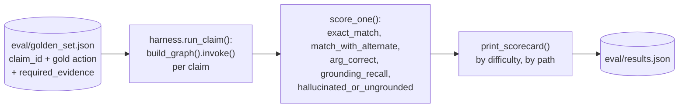
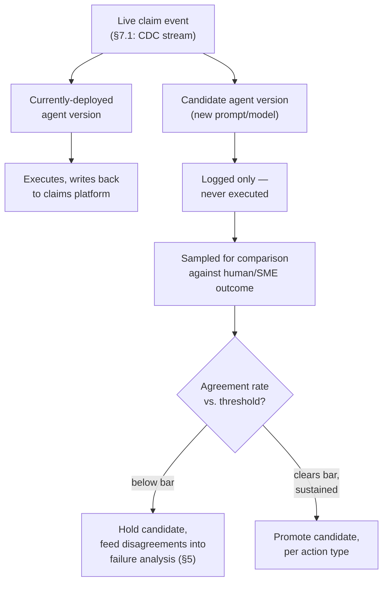

# Evaluation Plan — Insurance Claims Review Agent

*Companion to `design_report.md`, referenced by `eval/harness.py`'s own docstring. Grounded in what's actually implemented (`eval/harness.py`, `eval/golden_set.json`) — every claim below is marked **(implemented)** or **(proposed)** so this reads as a real plan, not an aspirational wishlist.*

---

## 0. Scope

This plan covers five things: how the evaluation dataset is curated (and kept honest), what's measured, how evaluation is actually run (today, offline, and where it needs to go for a live deployment), whether/how an LLM judge fits in, and how failures get bucketed and prioritized. It assumes the architecture in `design_report.md` — four deterministic override gates, one LLM reasoning step, deterministic post-hoc validation — and evaluates *that* system, not a generic RAG agent.

---

## 1. Evaluation Dataset Curation

### 1.1 Coverage strategy

**(implemented)** `eval/golden_set.json` currently holds 19 claims (10 original, 9 added in one pass specifically to close the gaps this section used to list) — every claim seeded into the Postgres claims table (`agent/db.py`) from `agent/claims_data.json` via `scripts/seed_claims_db.py`; `eval/harness.py` looks each one up with `db.get_claim(claim_id)`, not by reading the JSON file directly (design_report.md §2.1). Each row is not a random sample; every one was added for a specific reason, and reading those reasons is itself the coverage argument. Every gold label below was checked against a real run, not asserted; one (`CLM3009`) needed correcting after `--repeat` showed the first single run wasn't representative — see its notes in `golden_set.json` for the full evidence.

| Claim | `path` | `difficulty` | Why it's in the set |
|---|---|---|---|
| CLM1002, CLM1008 | `override` | easy | A single clean condition each (inactive; high-amount) — these should *never* reach the LLM, so a regression here means the rule engine broke, not the model. |
| CLM1003, CLM1004, CLM3001, CLM3002, CLM3003, CLM3004 | `override` | easy | **All six multi-condition collision pairs**, deliberate. `inactive` still wins outright regardless of what else fired (CLM3001-3003). Among the other three, no ranking is used any more: two or more of `high_amount`/`mismatch`/`missing_docs` firing together escalates outright to `route_to_senior_reviewer` (`multi_override_review`, design_report.md §3.1), rather than resolving to one condition's specific action. CLM3004 (`mismatch`+`missing_docs`, no `high_amount`) is the case that actually distinguishes this from the old ranked design: it used to resolve to `route_to_coding_review`, and now correctly resolves to `route_to_senior_reviewer` instead, re-verified against a real harness run after the change. Every case checks that every fired condition still appears in `validator_notes` (e.g. `also_triggered_mismatch`), not just whichever one(s) resolved it. |
| CLM3005 | `error` | easy | Unknown insurer, testing `retrieval.insurer_slug()`'s fail-closed `ValueError` path all the way through to a graceful `route_to_senior_reviewer` escalation. Finding this case exposed a real gap: `eval/harness.py` had no exception handling around `app.invoke()` at all (only `agent/run.py` did) — fixed by centralizing the error-response shape in `validator.pipeline_error_response()`, used by both callers now. |
| CLM1005 | `llm` | easy | **Regression-guard case**: an earlier retrieval bug caused the agent to misapply a Prior-Authorization-only documentation rule (§3.2) to a non-PA standard claim. Fixed by returning the full policy document instead of a ranked subset (`agent/retrieval.py`). Kept in the golden set specifically to catch that exact regression if it reappears. |
| CLM1001 | `llm` | hard | Genuinely ambiguous by design — tests whether the agent applies its *stated* documentation policy consistently, not whether there's a single defensible answer. |
| CLM1006 | `llm` | hard | **Confirmed flapping case.** Flaps between `approve_claim_payment` and `route_to_senior_reviewer` under `--repeat`. |
| CLM1009 | `llm` | easy | An appeal that should be denied because the appeal doesn't meet the policy's bar — a clean negative case on the appeal workflow. |
| CLM2001, CLM2002 | `llm` | hard | **Added specifically to close a coverage gap**: in both cases the deterministic diagnosis/procedure mismatch check *passes* (the codes are clinically consistent), so only correct policy-language reasoning against `provider_notes` catches the real issue (a preventive-screening exclusion; a medical-necessity "not for convenience" exclusion). These test genuine language understanding, not code-matching — the two only overlap in spirit with the override cases. |
| CLM3006, CLM3007 | `llm` | hard | Built to test genuinely *contradictory* evidence (a document present in `supporting_documents`, but `provider_notes` directly contradicting what its presence would imply); verified this does **not** produce escalation — the agent consistently trusts narrative content over a document's mere presence and resolves by denying. Real, valuable, reproducible behavior, but **it does not close the contradictory-evidence gap** below; that gap is still open. |
| CLM3008, CLM3009 | `llm` | hard | **Ambiguous `provider_notes`, as its own category, distinct from CLM1001's missing-document ambiguity or an ambiguous/silent policy.** CLM3008 (mild vagueness, no specific policy criterion at stake) is approved, not escalated. CLM3009 (vagueness bearing directly on Aetna §5.1's specific documentation criteria) denies 4/5 times, escalates 1/5. Together they show the agent's reaction tracks whether the ambiguity actually undermines a named policy requirement, not just the presence of a vague word — this closes the "ambiguous provider_notes" gap below, though not with the answer originally expected (escalation), with a denial. |

The organizing coverage matrix, updated to reflect what's now actually closed:

| Dimension | Values covered today | Gaps |
|---|---|---|
| `claim_type` | preapproval, standard, appeal | — |
| override condition | all four; **all six collision pairs now covered** (CLM1003, CLM1004, CLM3001-3004) | — |
| insurer | United Healthcare, Aetna, Blue Cross Blue Shield; unknown-insurer fail-closed path covered (CLM3005) | each insurer's policy text has different section numbers for the same concept (e.g. exclusions is §6 everywhere here, but that's a property of these three synthetic docs, not guaranteed in general) — still no case with a *fourth real* insurer's policy corpus, only the fail-closed rejection of an unconfigured one |
| ambiguity type | missing-doc (CLM1001), preventive-exclusion (CLM2001), necessity-not-documentation (CLM2002), narrative-vs-presence-flag conflict (CLM3006, CLM3007), ambiguous provider_notes (CLM3008, CLM3009) | **one of the three case-study-required robustness properties is still genuinely open**: no case with truly irresolvable contradictory evidence exists yet. CLM3006/CLM3007 were built for this and verified *not* to produce it — the agent found a principled way to resolve them (trust narrative content over document presence), which is a real and different finding, not a substitute for the original requirement. This remains the one gap in this row that hasn't actually been closed by any claim in the set. |
| difficulty | easy (11), hard (8) | — |
| consistency (flapping) | CLM1006 confirmed via `--repeat`; CLM3009 checked and found *not* to flap materially (4/4 on repeat) | no systematic sweep — every `hard` claim should get a `--repeat` pass, not just the ones that happened to look suspicious on a second run (§2.3's "standing metric" proposal) |

**(proposed)** The one real remaining gap: construct a genuinely irresolvable contradictory-evidence case. It's harder to build honestly within this claim schema than it looks — the obvious approach (a document's presence vs. a narrative field) turns out to be resolvable, as CLM3006/CLM3007 showed. A better construction likely needs two independently-sourced structured claim fields disagreeing with each other directly, not a structured field against free text, since free text seems to consistently win when the agent has to choose. Also still open: a fourth insurer with a real (not just absent) policy corpus, and a systematic `--repeat` sweep across every `hard` claim rather than ad hoc checks on claims that happened to look suspicious.

### 1.2 Policy snippets as ground-truth evidence

**(implemented)** Every golden-set row carries `required_evidence: {sections: [...], claim_fields: [...]}` — the minimum policy section ids and claim fields a *correct* rationale must reference. This is what makes grounding gradeable without a judge (§2.2, §4): `grounding_recall()` in `eval/harness.py` checks the response's actual `rationale` array against this set directly, no free-text comparison involved.

Two things worth being precise about, since they're easy to get wrong when curating more of these:
- **`required_evidence` is a floor, not a checklist.** A correct response may cite more than what's listed (e.g. a defensive citation of an exclusions section) — the metric is recall against the minimum, not exact-set match. See §2.2 for why this leaves a precision gap.
- **Sections and claim fields are both first-class ground truth, not just sections.** Several gold rows (CLM1002, CLM1003, CLM1004, CLM1008) have `"sections": []` and are grounded entirely in claim fields, because they're override cases — the LLM never runs, so there's no policy evidence to require. Treating `required_evidence` as "policy citations only" would silently make every override row un-scoreable on grounding.

**(proposed)** As the golden set grows past what one person can hand-label, curate `required_evidence` from **actual retrieved chunks for that claim**, not from memory of the policy document — an SME should have the exact chunk set retrieval would return in front of them while labeling, so the gold evidence set and the retrieval-time evidence set can never silently drift out of sync (today this drift risk is low, since retrieval always returns the full document — see `design_report.md` §2.2 — but it returns the moment ranking/top-k is reintroduced at scale).

### 1.3 Hold-out set strategy

**(implemented, by absence)** `prompt.md` contains **zero few-shot examples** today — it's pure instructions. That means there is currently no leakage risk between "claims used to write the prompt" and "claims used to score the prompt," because no claims are embedded in the prompt at all. This is worth stating plainly rather than assuming a hold-out discipline is needed where it currently isn't.

**(proposed)** This zero-leakage state won't survive prompt iteration by default — the first time someone adds a worked example to `prompt.md` to fix a failure mode, that claim must never also be a golden-set scoring row. Concretely:
- Maintain two disjoint pools going forward: an **exemplar pool** (claims that may ever appear in a prompt, as a few-shot example or in documentation) and a **frozen test pool** (`eval/golden_set.json`, as scored by the harness). A claim moves into the exemplar pool only by being explicitly removed from the test pool first — never both.
- **Freeze the test pool per release, version it like code.** `eval/golden_set.json` should be tagged/diffed alongside `prompt.md` and `agent/*.py` in whatever revision history this project ends up in, so a scorecard is always reproducible against the exact golden set that produced it.
- **Periodically add new, de-identified real claims**, SME-labeled the same way as CLM2001/CLM2002 were (added specifically to close a reasoning-coverage gap, not sampled randomly) — the goal is coverage of failure modes, not raw count.
- A model/prompt change is only evaluated against the frozen pool; if a change is motivated by a *specific* observed failure, that failure's claim gets added to the frozen pool (as a new regression-guard row, CLM1005-style) rather than being used to iterate the prompt and then silently double as its own test.

---

## 2. Metrics

### 2.1 Action / decision correctness

**(implemented)** — `eval/harness.py::score_one`:
- **`exact_match`** — predicted `decision` equals `gold_action`.
- **`match_with_alternate`** — predicted decision is in `{gold_action} ∪ acceptable_alternate_actions`. This exists because some cases (CLM1006, CLM2002) have a defensible secondary answer (usually `route_to_senior_reviewer`) alongside a primary gold label — collapsing that nuance into a single hard label would make a genuinely-acceptable escalation look like a wrong answer.
- **`arg_correct`** — only meaningful once the action matches (or matches-with-alternate): `payment_in_dollars == gold_payment`, or the requested-document set equals `gold_documents`.

**(proposed)** — not yet in the harness, worth adding before this scorecard is trusted as complete:
- **Confusion matrix by `claim_type` × override condition** — an aggregate accuracy number can stay flat while one specific slice (e.g. appeals) quietly degrades; a confusion matrix surfaces that immediately.
- **Cost-weighted scoring**, not just unweighted accuracy — a wrong `approve_claim_payment` (pays out incorrectly) is categorically worse than a wrong `route_to_senior_reviewer` (costs a human's time). Weight false-approves highest, false-denies second, wrong-escalates lowest, and report both the raw accuracy and the cost-weighted score side by side.
- **Override-miscomputed rate held to exactly zero as a release gate**, not just tracked — a wrong deterministic override is a code bug (§5), not a model quality issue, and should block a release outright rather than being averaged into an overall accuracy number.
- **Confidence calibration — currently missing entirely, and worth calling out plainly.** `confidence` is recorded on every LLM-path row (`score_one`) but nothing checks it against anything; it's a number the model reports about itself, with no independent verification, and self-reported LLM confidence is well known to not track actual correctness. Before it's trusted for anything beyond a prompted nudge toward escalation (`design_report.md` §4), bucket golden-set predictions by reported `confidence` (e.g. deciles) and check whether the `exact_match`/`match_with_alternate` rate *within* each bucket actually tracks the reported number — a calibration curve, or a single expected-calibration-error score. A model that reports 0.9 on cases it gets right only 60% of the time is actively misleading a reviewer who's learned to trust the number, which is arguably worse than not reporting one at all.

### 2.2 Evidence grounding quality

**(implemented)** — `grounding_recall()`: for each response, `(|required sections ∩ cited sections| + |required fields ∩ cited fields|) / |required_evidence total|` (1.0 when nothing is required, i.e. override rows).

**(implemented, revised)** — **`grounding_exhausted`**: `True` iff `grounding_retry_exhausted` appears in the response's `validator_notes` (`validator.grounding_failure_response`, design_report.md §3.2). This replaced the original design: a citation still ungrounded after one retry used to get dropped from the rationale while the underlying decision executed anyway; now the whole decision is discarded and replaced with `route_to_senior_reviewer`. This is the metric to watch, not the one below.

**(implemented, but very likely dead)** — **`hallucinated_or_ungrounded`**: `True` iff `dropped_ungrounded_or_hallucinated_assertion` appears in `validator_notes`. Kept in the scorer for now, but this branch (`validator._normalize_rationale`'s drop-path) is only reached from code that only runs when `grounding_problem()` already returned no problem, checking the same retrieved-section membership `_normalize_rationale` itself checks — so if the first check passed, the second one's drop-branch has nothing left to catch. Every real run in this project has shown `False` here, consistent with that. Not deleted, so a future regression that reopens this gap doesn't go unmeasured, but a 0% rate on this metric specifically is not evidence of a clean pipeline.

**(proposed)** — a real gap this plan should close:
- **Citation precision.** `grounding_recall` only checks that required evidence is *present*; a rationale that also cites extra, real-but-irrelevant sections currently scores perfectly. Add a precision metric: of the sections/fields actually cited, what fraction are in an SME-approved "acceptable evidence" set for that claim (a superset of `required_evidence`, since a correct answer may legitimately cite more than the floor — see §1.2)? Without this, a model that over-cites defensively is indistinguishable from one that cites precisely.
- **Citation faithfulness, distinct from citation validity.** The deterministic check (`validator.grounding_problem`) verifies a cited section *id* exists in the retrieved set — it does **not** verify that the model's characterization of what that section *says* is accurate. A response can cite a real section and still misdescribe its content; no current metric catches that. This is exactly the gap §4 (LLM-as-a-judge) is for — it's not a deterministic-check gap that can be closed with more code, since it requires reading comprehension over the cited text.

### 2.3 Robustness to missing/ambiguous inputs

**(implemented)** — `print_scorecard()` breaks every metric out **by `difficulty`** (easy/hard) and **by `path`** (override/llm), so a robustness regression on the hard/ambiguous slice is visible separately from the easy-slice average. `run_repeat()` (the `--repeat N --claim X` CLI flag) runs one claim N times and reports the decision distribution and an agreement rate — this is how CLM1006's flapping behavior was actually caught.

**(proposed)**:
- **A dedicated ambiguity-type tag**, not just a binary `difficulty` flag — today's "hard" bucket conflates at least three distinct failure modes (strict-vs-loose documentation reading, preventive-exclusion language, necessity-vs-convenience language). Splitting these into their own tags lets a regression be attributed to *which kind* of ambiguity got worse, not just "hard cases got worse."
- **Consistency as a standing metric, not just an ad hoc CLI flag.** Run `--repeat 3` (or more) automatically on every `hard` claim as part of the regular scorecard, not only when someone manually suspects flapping — report an agreement rate per hard claim alongside its single-shot score.
- **Abstention correctness.** Recall of cases that *should* result in `request_missing_documentation` or `route_to_senior_reviewer` rather than a confident approve/deny — but also its precision counterpart (a model that escalates everything trivially maximizes recall while being useless). Report both together; neither alone is a meaningful robustness signal.
- **A clean-baseline comparison slice.** Robustness is a *relative* claim ("the agent does worse on ambiguous inputs than on clean ones") — report the easy-slice score as the baseline every hard-slice number is compared against, not just the hard-slice number in isolation.

---

## 3. How Evaluation Is Performed

### 3.1 How metrics are computed

Directly from the shipped scorer (`eval/harness.py`), so this section is verifiable, not descriptive:

```python
def grounding_recall(final: dict, required: dict) -> float:
    req_sections = set(required.get("sections", []))
    req_fields = set(required.get("claim_fields", []))
    total_required = len(req_sections) + len(req_fields)
    if total_required == 0:
        return 1.0
    got_sections, got_fields = cited_sections_and_fields(final)
    hit = len(req_sections & got_sections) + len(req_fields & got_fields)
    return hit / total_required

def score_one(gold: dict, final: dict) -> dict:
    predicted = final["decision"]
    acceptable = {gold["gold_action"], *gold.get("acceptable_alternate_actions", [])}
    exact_match = predicted == gold["gold_action"]
    match_with_alternate = predicted in acceptable
    # ...arg_correct checks payment_in_dollars / documents_requested when matched...
    grounding_exhausted = "grounding_retry_exhausted" in final.get("validator_notes", [])
    hallucinated = "dropped_ungrounded_or_hallucinated_assertion" in final.get("validator_notes", [])
    return {...}
```

Aggregates (`print_scorecard`): `exact_acc`, `alt_acc`, `arg_acc` (over matched rows only), `avg_grounding_recall`, `hallucination_rate` — each also broken out by `difficulty` and `path`.

### 3.2 Offline harness flow

**(implemented)**



Run with `python -m eval.harness` (full set), `--claim CLM1006` (one claim), or `--repeat 3 --claim CLM1006` (consistency check, §2.3). Each run is a batch invocation of the *real* compiled LangGraph agent — no mocking of the LLM step — against side-effect-free claims (nothing here calls out to the actual claims-administration platform described in `design_report.md` §1).

**(proposed)** — not implemented yet: wire this into CI as a merge gate. Concretely: store the last-approved scorecard as a baseline artifact; a PR run computes a new scorecard and fails the build if `exact_acc`/`match_with_alternate`/`avg_grounding_recall` regresses beyond a small tolerance, if `hallucination_rate` increases at all, or if **any** override-path row stops being an exact match (§2.1, §5 — that's a P0 rule-engine bug by definition, zero tolerance, not a tolerance band). Tag every scorecard with model version, prompt version (a hash of `prompt.md`), and git commit so a regression can be bisected.

### 3.3 Online shadow mode & human-in-the-loop guardrails

**(not implemented — this is a design, not a description of existing code.)** There is currently no live-traffic pipeline at all — the local reference implementation reads a seeded database, not the claim-event stream `design_report.md` §1 describes. The design, once that integration exists:



Guardrails:
- **Shadow, never execute.** The candidate version's decision is logged and compared, but the currently-deployed version's decision is what actually executes — a candidate cannot affect a real claim until promoted.
- **Promotion is per action type, not all-or-nothing.** `deny_claim` only moves to auto-execute once shadow agreement with human/SME outcomes clears a bar (e.g. ≥99%) over a minimum sample size; `approve_claim_payment` above some dollar floor and `route_to_senior_reviewer` (already a hard override path, §3.1 of `design_report.md`) can reasonably require a human sign-off *indefinitely*, independent of shadow performance, since the cost of a wrong approve is asymmetric.
- **Canary ramp, not a binary switch.** Once a candidate clears its bar, auto-execution starts at a small live percentage and ramps up, with an automatic rollback if the agreement rate drops on a rolling window post-promotion (a model or upstream prompt regression should trigger the same rollback path as a failed shadow evaluation, not require a human to notice first).
- **Every disagreement is a failure-analysis input** (§5), not just a number — a shadow run that disagrees with a human is exactly the kind of case that should become a new golden-set row (§1.3), the same way CLM1005 became a permanent regression guard after a real bug was found.

---

## 4. LLM-as-a-Judge

**Decision: not used for the primary release gate.** Everything in §2.1 and §2.2's *implemented* metrics has a gold label or a gold evidence set — there is no reason to let a second model's variance decide something that's already known well enough to score deterministically. This matches `design_report.md` §6's design.

**Where a judge is actually useful: citation faithfulness (§2.2's gap).** The deterministic check verifies a cited section id is real; it cannot verify the model's assertion about that section's *content* is accurate — that requires reading comprehension over the text, which is exactly what an LLM judge is good at and a set-membership check structurally cannot do.

Sample judge prompt, anchored strictly to the retrieved text (not "is this plausible"):

```
You will grade one claims-agent response. You are given: the claim record, the exact
retrieved policy section text for every section the response cited (not just section
ids), and the agent's rationale array.

For EACH rationale entry that cites a policy section, answer strictly from the provided
section text — do not use outside knowledge of insurance policy or what a section
"probably" says:

1. faithful (bool): Is this assertion actually supported by the cited section's text?
   Answer false if the section is real but doesn't say what the assertion claims, even
   if the assertion sounds plausible.
2. justification (str, one sentence): quote or closely paraphrase the specific text
   that supports (or fails to support) the assertion.

Then, for the response as a whole:
3. invented_rules (bool): does the summary or any rationale entry state a coverage
   rule, threshold, or requirement NOT present in any provided section or claim field?
4. clarity (int, 1-5): would a claims reviewer understand the decision and next step
   without independently re-reading the policy?

Return JSON:
{
  "per_assertion": [{"assertion": str, "faithful": bool, "justification": str}, ...],
  "invented_rules": bool,
  "clarity": int
}
```

**When to trust it:**
- As a **relative** signal comparing two prompt/model variants ("did faithfulness improve") — ranking is far more reliable than trusting an absolute score in isolation.
- As a **triage/sampling signal** — route the lowest-clarity or judge-flagged-unfaithful rows to the front of the blinded SME review queue (§1.3-style human review), rather than replacing that review.
- For catching the **one category of error the deterministic pipeline structurally cannot see**: a real citation that misdescribes its own section's content.

**When not to trust it:**
- **Never as the sole release gate.** Deterministic metrics (§2) plus periodic human audit remain the actual gate; judge output is a secondary/triage signal, full stop — this mirrors `design_report.md` §6's stance and the reasoning is the same: a judge grading a decision that already has a gold label just reintroduces model variance where none was needed.
- **Not without a periodic human-agreement calibration.** Run a monthly blinded audit — an SME labels ~50 rows the same way (`faithful`/`unfaithful`, clarity 1-5) — and compute judge–human agreement (e.g. Cohen's kappa). Only trust the judge's *ranking* of prompt/model changes once kappa clears an agreed bar (e.g. 0.7); below that, the judge's output is noise dressed up as a number.
- **Watch for self-preference bias** if the judge is the same model family as the generator — it can be systematically lenient toward its own family's phrasing. Mitigate by anchoring the rubric to strict yes/no traceability against literal provided text (as above), not an open-ended quality score, and consider a different model as judge if this is ever suspected.
- **Watch for verbosity/position bias** generally — a longer, more hedged rationale can read as "more faithful" even when no more correct. The per-assertion, quote-anchored format above exists specifically to blunt this; an open "rate this response 1-10" prompt would not.
- **Single-call judge output is noisy.** For anything used to gate an actual rollout decision (not just casual triage), take a majority vote over N judge calls rather than trusting one.
- **Never let the judge grade coverage/medical-necessity correctness itself** (the "is this the right decision" question) — that's precisely the dimension §2.1 already covers deterministically against a gold label. Asking a judge to re-decide it reintroduces the exact hallucination-tolerant, fluent-but-wrong risk the deterministic-gate design exists to avoid.

---

## 5. Failure Analysis

**Bucket every failing/flagged row by:**

- **Pipeline stage** (named to match `agent/graph.py`'s actual routes):
  - `override-miscomputed` — a deterministic override (`inactive`/`mismatch`/`missing_docs`/`high_amount`) fired wrong or failed to fire. **P0.** This is a code bug, not a model-quality issue, and should be exactly zero at all times (§2.1, §3.2's CI-gate proposal).
  - `reasoning-error` — the LLM path had complete, correct evidence and still reached the wrong decision.
  - `grounding-exhausted` — the one deterministic retry still failed, and the decision was discarded entirely and replaced with `route_to_senior_reviewer` (`grounding_retry_exhausted`, §2.2) — this is now a hard stop, not a silent degrade-and-continue. A rising rate here means the retry alone isn't fixing whatever's wrong with retrieval or the prompt often enough, and is worth investigating even though every case here is, by construction, routed to a human rather than executed wrong.
  - `citation-unfaithful` — caught only via the judge (§4) or SME review: a real, valid citation that misdescribes its own section's content.
  - `format-violation` — a malformed tool call; should be near-zero given the schema-constrained output contract (§4 of `design_report.md`), but worth its own bucket precisely because it should be rare — a rising rate here signals a schema or SDK-version problem, not a reasoning problem.
- **Claim type / override condition** the failure occurred under (cross-reference the confusion matrix, §2.1).
- **Evidence-failure sub-type**: missing required evidence vs. invalid citation vs. real-but-misapplied section vs. unsupported claim-field assertion — distinguishing these tells you whether the fix is a retrieval problem, a prompt problem, or a validator problem.
- **Severity**: `wrong-approve` (financial + compliance exposure, highest) > `wrong-deny` (member harm) > `missed-escalation`/`missing-doc-request` (delay, recoverable) > `wrong-escalate` (cost/latency only, lowest).

**Prioritization**: rank buckets by **frequency × severity**, not either alone — a rare wrong-approve can outrank a common wrong-escalate. Require **zero P0s** (`override-miscomputed`) before shipping, unconditionally; everything else is ranked, not gated.

**The feedback loop that actually closes this** (already demonstrated once, for real, in this project): CLM1005 exists in the golden set today *because* a real retrieval bug was found, root-caused, fixed, and then turned into a permanent regression-guard row so the same failure can never silently reappear (§1.1). That's the process to formalize, not just describe: every bucketed failure that gets fixed should produce a new golden-set row (or a repeat-consistency check, for a flapping case like CLM1006) — failure analysis's output is new evaluation coverage, not just a bug-tracker ticket.

**Tracking**: until a dashboard exists, diff `eval/results.json` bucket-by-bucket across runs, not just the aggregate scorecard printed by `print_scorecard()` — an unchanged aggregate can hide one bucket improving while another quietly regresses (§2.3). Once tracing is centralized (Langfuse or an equivalent audit log, `design_report.md` §5), tag spans by these same bucket names so the same taxonomy applies to both offline scorecards and live shadow-mode disagreements (§3.3).
